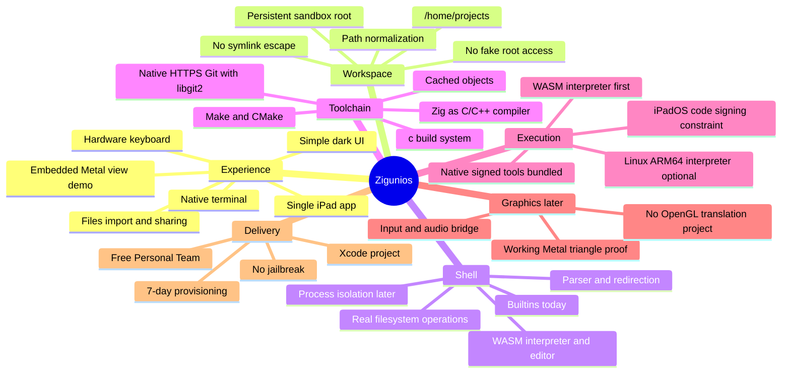
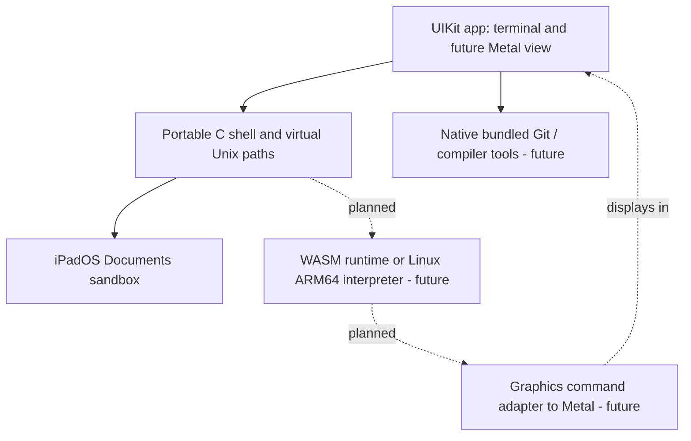

# Zigunios: mind map and design decisions



## Guiding principles

1. **Don't write an OS kernel.** iPadOS already provides an optimized Apple Silicon kernel, filesystem, GPU driver, network and threading. The app does not gain kernel privileges by using Zig.
2. **Zig is a toolchain, not the runtime language requirement.** Use its Clang-based `zig cc` / `zig c++` as convenient compilers when we have a supported execution format. The app UI is Objective-C and the shell is portable C11.
3. **One app; no fake Linux desktop.** Terminal first; later show individual program output in an embedded Metal view.
4. **Honest Unix compatibility.** A small shell is not Bash. Running native CLI tools and CMake requires working process execution, pipes and ABI support. Don't advertise these until proven.
5. **Protect persistence.** Confine all mutable files to the Documents workspace; keep project files across regular app relaunches and app updates.
6. **Prioritize feasibility and performance measurements.** Avoid layering expensive emulators unless a representative workload proves necessary.

## Proposed layers



## The hardest technical problem: executing compiled code

On iPadOS, freshly generated ARM64 machine code is not equivalent to a loadable, signed native app. Compiling `.c` to ARM64 inside a sandbox does **not** make `./game` executable. Arbitrary spawned processes, `fork/exec` and unsigned dynamic code cannot be assumed available. Only allowed native code can run directly.

**Candidate A: interpreted WebAssembly:** Cross-compile C/C++ to WASM, interpret in a bundled runtime; design a small WASI/POSIX bridge. Fast to validate, but CMake subprocesses, `fork`, dynamic linking and native graphics require explicit compatibility layers. A WASM runtime using JIT is not automatically App Store-compatible.

**Candidate B: Linux ARM64 user-mode interpreter:** Load ELF, interpret CPU instructions and implement Linux syscalls. More existing binaries possible, but the compiler and CPU-heavy workloads incur significant emulation costs. Can reuse ideas/code from existing projects after license review.

**Candidate C: native prebundled tools:** Compile Git, compiler frontend and static utility code into signed app artifacts, call their APIs directly where safe. Fastest for allowed operations but `exec` behavior is not the same as Linux.

A practical system probably combines A + C, with B only if useful. Do not build a new kernel or pretend all Unix binaries run unchanged.

## Milestones / acceptance criteria

| Stage | Goal | Status |
|---|---|---|
| 0 | iPad app, persistent shell workspace, Files integration | Verified on a physical iPad in v0.1 |
| 1 | Real Git repositories and basic Git commands | Implemented with static libgit2, pending device behavior verification |
| 1b | Native UTF-8 source editor and file tools | Implemented |
| 2a | Execute imported WASM / WASI programs without JIT | Implemented with wasm3; use `wasm demo` or `wasm FILE.wasm` |
| 2b | Native-hosted C/C++ compiler emitting WASM | Not implemented; requires substantial Clang/Zig toolchain integration |
| 3 | `c build run` and Unix process semantics | Not implemented |
| 4 | General Make/CMake project compatibility | Not implemented |
| 5a | Native Metal output inside the app | Implemented proof-of-concept: `metal demo` |
| 5b | Compile and render arbitrary games in-process | Not implemented |
| 6 | Wider Linux ABI/package support | Deferred |

### Test commands on the device

```sh
cd /home/projects
git clone https://github.com/libgit2/clar.git
cd clar
git status
git log
edit README.md
git diff
wasm demo
metal demo
```

**Zig is intended to provide the C/C++ compiler, not to become a new operating-system kernel.** The important remaining work is porting a compiler such as Zig/Clang into signed iPadOS host code and compiling to a format the app can interpret. A `zig` binary built for Linux or macOS cannot simply be placed in the iPad app and executed. Likewise, the WASM interpreter cannot run native AArch64 ELF or Mach-O binaries. These limits are enforced by iPadOS and not solved by changing the display backend.

