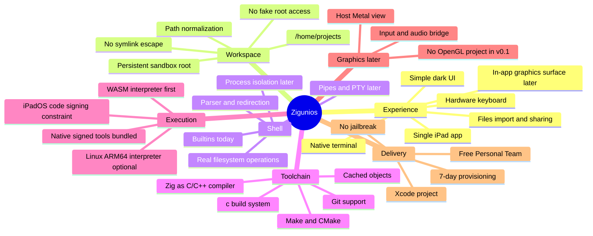
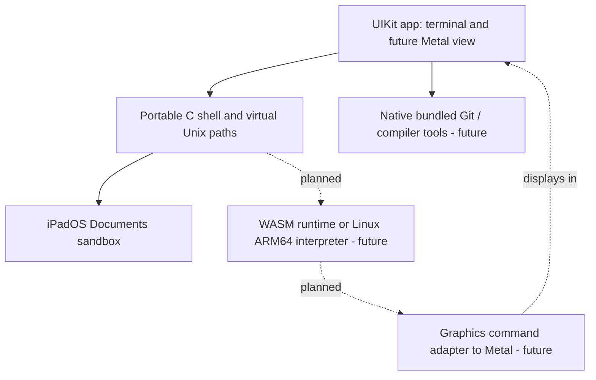

# Zigunios: mind map and design decisions



## Guiding principles

1. **Don't write an OS kernel.** iPadOS already provides an optimized Apple Silicon kernel, filesystem, GPU driver, network and threading. The app does not gain kernel privileges by using Zig.
2. **Zig is a toolchain, not the runtime language requirement.** Use its Clang-based `zig cc` / `zig c++` as convenient compilers when we have a supported execution format. The app UI is Objective-C and the shell is portable C11.
3. **One app; no fake Linux desktop.** Terminal first; later show individual program output in an embedded Metal view.
4. **Honest Unix compatibility.** A small shell is not Bash. Running native CLI tools and CMake requires working process execution, pipes and ABI support. Don't advertise these until proven.
5. **Protect persistence.** Confine all mutable files to the Documents workspace; keep project files across regular app relaunches and app updates.
6. **Prioritize feasibility and performance measurements.** Avoid layering expensive emulators unless a representative workload proves necessary.

## Proposed layers



## The hardest technical problem: executing compiled code

On iPadOS, freshly generated ARM64 machine code is not equivalent to a loadable, signed native app. Compiling `.c` to ARM64 inside a sandbox does **not** make `./game` executable. Arbitrary spawned processes, `fork/exec` and unsigned dynamic code cannot be assumed available. Only allowed native code can run directly.

**Candidate A: interpreted WebAssembly:** Cross-compile C/C++ to WASM, interpret in a bundled runtime; design a small WASI/POSIX bridge. Fast to validate, but CMake subprocesses, `fork`, dynamic linking and native graphics require explicit compatibility layers. A WASM runtime using JIT is not automatically App Store-compatible.

**Candidate B: Linux ARM64 user-mode interpreter:** Load ELF, interpret CPU instructions and implement Linux syscalls. More existing binaries possible, but the compiler and CPU-heavy workloads incur significant emulation costs. Can reuse ideas/code from existing projects after license review.

**Candidate C: native prebundled tools:** Compile Git, compiler frontend and static utility code into signed app artifacts, call their APIs directly where safe. Fastest for allowed operations but `exec` behavior is not the same as Linux.

A practical system probably combines A + C, with B only if useful. Do not build a new kernel or pretend all Unix binaries run unchanged.

## Milestones / acceptance criteria

| Stage | Goal | Status |
|---|---|---|
| 0 | iPad app, terminal, persistent sandbox, shell builtins, Files integration | Implemented in source; iPad build not yet device-verified |
| 1 | Real Git clone/fetch and project directory management | Not implemented |
| 2 | Demonstrate bundled C compiler: source → interpreted runnable program | Not implemented |
| 3 | Integrate `c` build-system configuration and basic compile/run workflow | Not implemented |
| 4 | Basic process ABI, pipes, environment, exit codes, correct shell scripting | Not implemented |
| 5 | CMake/Make projects and selected libraries | Not implemented |
| 6 | Embedded Metal surface for compiled app rendering; input/audio forwarding | Not implemented |
| 7 | More Linux compatibility as justified by actual project needs | Not implemented |

### First test after installing v0.1

```sh
pwd
ls
mkdir demo
cd demo
echo hello > hello.txt
cat hello.txt
cd ..
ls
```

After stage 1, the next test is a real `git clone`. After stage 2, compile a tiny C program and execute it under the approved runtime. **A full `c build run` on an arbitrary raylib project is not currently possible.**
